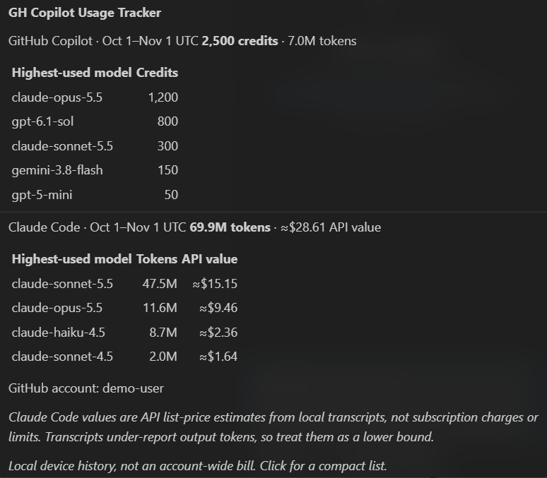
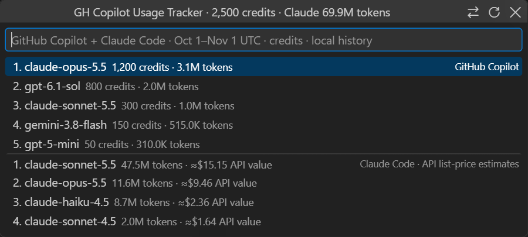

# GH Copilot Usage Tracker

**Track your GitHub Copilot usage by model: AI credits, input/output tokens, and monthly usage totals.**

GH Copilot Usage Tracker works with **GitHub Copilot Chat in VS Code, Copilot agent sessions, the Copilot SDK, and Copilot CLI** using usage records available on your local device. It adds a compact **Copilot credits** indicator to the **bottom-right status bar**, with a small hover summary and click popup—not a Terminal or docked panel.

**Also use Claude Code?** If the **Claude Code extension for VS Code** (or the Claude Code CLI) has written local transcripts on this device, its token usage by model appears in the **same hover and popup**, in its own section. No setup is needed; see [Claude Code usage](#claude-code-usage).

This independent community extension is **not an official GitHub product or an account-wide billing report**, and it is not an Anthropic product. Estimates and partial data are labeled. Nothing is uploaded to a usage-collection service.

The status bar is used because stable VS Code APIs support rich native hover content there, but do not expose a custom hover window attached to the chat-toolbar contribution. No private APIs or renderer injection are used.

## Which usage is shown

By default (`aiUsageCreditsMeter.provider` = `both`) the hover and popup have two separate sections:

* **GitHub Copilot** — VS Code chat, agent sessions, SDK and CLI: AI credits and tokens by model.
* **Claude Code** — listed only when local Claude Code transcripts exist: tokens and an API list-price value by model.

The two are **never added together**: Copilot credits are what GitHub bills, while Claude Code values are estimates and not a Claude subscription charge. Use **GH Copilot Usage Tracker: Select Chat Provider** from the Command Palette (or the `aiUsageCreditsMeter.provider` setting) to show **GitHub Copilot only** or **Claude Code only**. A Claude or Gemini model used **inside GitHub Copilot** is Copilot usage and stays in the Copilot section.

## Install

Install from the [Visual Studio Marketplace](https://marketplace.visualstudio.com/items?itemName=apkola29.ai-usage-credits-meter), or download the `.vsix` from [the project releases](https://github.com/apkola29/vscode_extensions/releases), then
run **Extensions: Install from VSIX...** and reload the window. Requires desktop VS Code **1.141 or newer**.
This is an independent community extension, not an official GitHub or Anthropic product.

The extension ID remains **`apkola29.ai-usage-credits-meter`** so existing installs update normally; its visible name is **GH Copilot Usage Tracker**. Command and setting IDs are unchanged for compatibility.

## Screenshots

These native VS Code captures use **synthetic usage and a fictional demo account**. The values illustrate the interface, not real usage, model availability, or pricing. The hover and popup show a Copilot section and a Claude Code section; the Claude section appears only on devices that have Claude Code transcripts.

### Status-bar indicator


The compact indicator stays in the status bar without opening a Terminal or docked panel.

### Hover summary



Hover to see each provider's cycle total and highest-used models; move the pointer away to dismiss.

### Click popup



Click for the floating list. Close it with **×**, **Esc**, or a click outside.

## What you see

**Hover:** a small native tooltip shows the cycle total and the five highest-used models for **GitHub Copilot** and, when present, **Claude Code**. It disappears when the pointer moves away.

**Click:** a compact floating list shows the five highest-used models per provider for the configured ranking. Close it using **×**, **Esc**, or clicking outside. Use **Show all models** only if you want the longer list.

* Each compact row shows credits (Copilot) or API value (Claude Code) and tokens. Selecting a model copies its row.
* The popup has **Refresh** and a **tokens/credits ranking toggle** (for Claude Code, "credits" ranks by API value).
* **Command Palette:** `GH Copilot Usage Tracker: Show Compact Usage Popup` opens the same small list.
* **Show Detailed Dashboard** remains optional in the Command Palette; it is never opened by a normal hover or click.
* **Use My GitHub Account:** reuse VS Code's GitHub sign-in rather than entering a PAT or username.

`≈` marks numbers that include an estimate (see *Accuracy*).

A single summary scan warms the hover after startup. Further scans are on demand; there is no polling loop. Cached summaries expire after one minute and are invalidated when the provider, settings, or GitHub sign-in changes.

## Claude Code usage

The **Claude Code extension for VS Code** bundles the Claude Code CLI and shares its conversation history, so both write transcripts under `~/.claude/projects` (or under `CLAUDE_CONFIG_DIR`, which names one directory). The tracker reads only those transcripts, **locally and read-only**, and shows per model:

* **Tokens** — input, output and cache tokens recorded in the transcripts.
* **API value** — those tokens priced at Anthropic's standard API list rates, or the transcript's own recorded cost when present. A model without a known list price shows its tokens and `n/a`.

What this is **not**:

* It is **not your Claude bill**. Usage included in a Pro, Max, Team or Enterprise plan is not charged per token, while usage beyond it and API/Console usage are metered by Anthropic and can include surcharges (fast mode, data residency) that transcripts do not record. "API value" is only a list-price comparison figure.
* It is a **lower bound**. Anthropic's Agent SDK documentation states that per-step output token counts in the message stream are placeholders (input and cache tokens are accurate). Claude Code transcripts are written from that stream, so output tokens, and the value derived from them, are likely under-reported. Only Claude Haiku 5.5's documented higher rates for prompts over 100,000 tokens are modelled.
* It does **not show plan limits or remaining allowance**. Those live in your Anthropic account and are intentionally not requested; the tracker never reads Claude sign-in or credential files and makes no network calls.
* It cannot see usage whose transcripts are gone or not on this device: transcripts older than Claude Code's retention (**30 days** by default, `cleanupPeriodDays`), sessions started with persistence disabled, or a differently redirected config directory. In **Remote SSH, WSL and dev-container** windows the Claude Code extension runs remotely, so its transcripts are not on the local device that this extension reads.
* Claude Code sessions that GitHub Copilot also recorded are left in the Copilot section when they share a session id, so the same usage is not listed twice. This match is best-effort; a session without a matching id could appear in both sections.

Claude Code usage appears automatically when transcripts are found. To turn it off, set `aiUsageCreditsMeter.provider` to `githubCopilot`. To read a different location, set `aiUsageCreditsMeter.claudeConfigDirs`. This part is a **preview**: Claude Code's local file format can change, and values are estimates.

## Where the numbers come from

Usage records are read **locally and read-only**. The tracker does not upload prompts, transcripts, usage records, or credentials. Optional account connection uses VS Code's native GitHub authentication broker; it is not an independent password/PAT login.

## Identity and safety

* Reuses the existing VS Code GitHub identity with only `read:user` permissions. If several accounts are present, select the account you use with Copilot; the tracker does not guess.
* Authentication tokens are never sent to the worker, tooltip, popup, or optional webview, persisted by the tracker, or written to its logs. Only the chosen account ID preference and displayed account label are used.
* Historical local records are **device-scoped**, not guaranteed account-scoped. Untagged records cannot prove which GitHub account incurred them; this is stated in the UI. These numbers are not an authoritative account-wide invoice.
* Reads the current VS Code profile and the current OS user's Copilot stores, plus Claude Code's `projects` transcripts when Claude Code usage is shown. It never opens Claude sign-in, credential or account files. Provider/data-directory settings are machine-scoped, not controlled by a repository.
* Disabled in untrusted and virtual workspaces. No production HTTP listener, debugging port, child shell, or third-party collector.
* Native hover Markdown is untrusted and has HTML disabled; local model/account text is escaped. The optional dashboard still has scripts disabled, no local resource access, nonce-protected styles, and a CSP blocking scripts and network connections.
* One lazy worker, at most four queued scans, duplicate-request coalescing, a 120-second timeout, and termination after 30 seconds idle or extension deactivation.
* Worker heap limits are 512 MiB old-generation and 32 MiB young-generation. The parsed-file cache is limited to 256 files shared by both providers (a full cache keeps its files rather than evicting them); Claude Code transcripts are compacted to one entry per message, records over 8 MiB are skipped and counted, and prompt/transcript text is not retained in the cache. If the combined scan fails, the tracker shows GitHub Copilot alone and says Claude Code could not be read.
* Read/parse failures are visible. Future changes to VS Code or Copilot's local formats still require regression testing; no implementation can guarantee that future releases will never introduce an issue.

| Tool | Source | Credits |
|---|---|---|
| Copilot agent / CLI | `~/.copilot/session-store.db` and `~/.copilot/session-state/*/events.jsonl` | GitHub AI Credits as billed (exact per call/model; some estimates for long or interrupted sessions) |
| VS Code chat | `<VS Code User>/workspaceStorage/*/chatSessions/*.jsonl` | GitHub AI Credits as billed, per request |
| Claude Code | `<claude config>/projects/**/*.jsonl` (`CLAUDE_CONFIG_DIR`, or `~/.config/claude` and `~/.claude`) | Tokens, plus Anthropic API list price converted to credits (`costUSD` is used when the transcript has it). An estimate, not a subscription charge. |

### Billing basis

* Since 2026-06-01, Copilot bills in GitHub AI Credits, priced per token per model.
* For the Claude models checked (Opus 4.7–5, Opus 5.5, Sonnet 5), GitHub's per-token billing equals Anthropic's list price, so the tools are directly comparable.
* The billing cycle is the calendar month in UTC; set `aiUsageCreditsMeter.cycleResetDay` if yours differs.

## Accuracy

* **Copilot.** Finished agent/CLI runs and VS Code chat requests are exact for credits.
  * VS Code chat input tokens are the final prompt size of each request, so they are a lower bound.
  * Long agent sessions that are still running, or that ended without a clean shutdown, only expose a session-level credit total. That total is split across models using each call's model tag and marked `≈`.
* **Claude Code.**
  * Each message is counted once: streaming duplicates, superseded transcript copies and messages copied into resumed sessions are removed.
  * Token totals include cache reads and writes, as recorded in the transcripts. Output tokens can be under-reported there (see *Claude Code usage*).
  * Values reflect API list price, not your Claude subscription, and exclude usage whose transcripts have been deleted (30 days by default, `cleanupPeriodDays`).
* **Scope.** Only usage on **this machine** is included.

## Settings

| Setting | Default | |
|---|---|---|
| `aiUsageCreditsMeter.provider` | `both` | `both` (GitHub Copilot, plus Claude Code when transcripts exist), `githubCopilot`, or `claudeCode` (preview) |
| `aiUsageCreditsMeter.sortBy` | `tokens` | Rank by `tokens` or `credits` |
| `aiUsageCreditsMeter.cycleResetDay` | `1` | UTC day of month the cycle resets |
| `aiUsageCreditsMeter.claudeConfigDirs` | `[]` | Override the Claude Code config directories (up to 8 absolute paths; Windows device paths are ignored) |

## Development

```powershell
npm test               # fixture tests (node:test)
npm run usage          # print both providers in a terminal (add -- --provider githubCopilot|claudeCode, or -- --validate to cross-check Copilot sources)
npm run test:vscode    # integration test in an isolated VS Code instance (add -- --vsix <file> to test a package)
npm run test:vscode -- --agents # run it in the Agents/Sessions window
npm run test:popup     # real hover -> mouse-leave dismissal; click -> close/Escape/click-away
npm run package        # build the .vsix offline
npm run package:vsce   # standard vsce package and its credential/file checks
node test\toolbar.js --vsix ai-usage-credits-meter-0.5.0.vsix # same native-UI test on the installed package
node test\toolbar.js --screenshots media\screenshots # regenerate public-safe demo screenshots
code --install-extension ai-usage-credits-meter-0.5.0.vsix
```

Requires VS Code 1.141+. It uses the built-in `node:sqlite`, so there are no native dependencies. UI-click tests launch an isolated profile with a temporary loopback debugging port and stop only their owned processes (matching PID and creation time) on exit; those test scripts are excluded from the VSIX.

Screenshot mode uses a disposable development copy with synthetic local stores and a fictional identity. It does not read your Copilot history or GitHub account. The test-only identity replacement is never included in a release.

Keep older installed-version folders until VS Code has reloaded. Let VS Code's extension manager clean them up; manually deleting a version still cached by an open window breaks activation.

## Public source and privacy

[Source project](https://github.com/apkola29/vscode_extensions/tree/main/extensions/ai-credits-usage-tracker)
and [issue tracker](https://github.com/apkola29/vscode_extensions/issues).
See the repository [privacy policy](../../PRIVACY.md) and [security policy](../../SECURITY.md).
Only synthetic fixtures are included in public tests; no personal usage data or session logs are bundled.

Licensed under [MIT](LICENSE).
